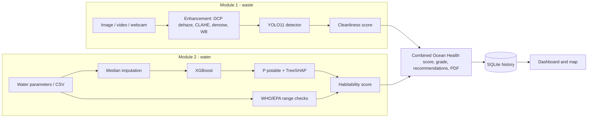

# Ocean Waste Detection and Water Habitability Test

A unified ML platform with two modules in one Streamlit app:

1. **Underwater waste detection**: YOLO11 (Ultralytics) detects 15 classes of marine litter in images, video, webcam snapshots and live camera streams, with optional dark-channel-prior dehazing and CLAHE enhancement.
2. **Water potability / habitability**: XGBoost classifies water as potable or non-potable. Each result comes with a SHAP explanation, WHO/EPA traffic-light range checks and a 0-100 habitability score.

A combined **Ocean Health Report** (graded A-E, exportable as PDF), a SQLite-backed dashboard with a site map, and a model-performance page complete the app.

## Architecture



## Results (RTX 4050 Laptop GPU)

| Module | Data | Metric (held-out test split) |
|---|---|---|
| YOLO11s waste detector, `--mode full` (100 epochs, 116 min, best epoch 85) | **Kaggle "Underwater Plastic Pollution Detection"** (CC BY 4.0), 5,130 images; test = 513 images | mAP@0.5 **0.632**, mAP@0.5:0.95 **0.398**, precision 0.730, recall 0.610, F1 0.664 |
| XGBoost potability (Optuna-selected) | **real** Kaggle Water Potability (3,276 rows) | ROC-AUC **0.680**, accuracy 0.627, F1 0.511 (5-fold CV ROC-AUC 0.677) |

Per-class test mAP@0.5 for the waste detector:

| Class | mAP@0.5 | Class | mAP@0.5 |
|---|---|---|---|
| cloth (masks, gloves) | 0.97 | rope / net | 0.60 |
| plastic (bags, film) | 0.93 | plastic bottle | 0.60 |
| other debris | 0.90 | glass | 0.41 |
| rubber / tyre | 0.65 | metal | 0.40 |
| fishing gear (rods) | 0.60 | can | 0.26 |

What these numbers mean:
- **The split is leak-free.** The Kaggle export contains flipped copies of most images (only 2,343 originals among 5,130 images). Each original and its copies are kept in the same split, so test images are never mirror images of training images.
- **Rare classes are weaker.** Cans, glass and metal have only about 60-340 training boxes each, so their scores are lower.
- **Dense piles are still hard.** In very crowded scenes with dozens of overlapping bottles, the model finds the clearer items and misses many in the pile; lowering the confidence threshold to about 0.15 helps.
- **Earlier experiment.** A model trained on TrashCan 1.0 (deep-sea ROV footage) reached only mAP@0.5 0.06 on its test videos (0.34 class-agnostic) and transferred poorly to shallow-water photos, so TrashCan is disabled in `config.yaml`.
- Inference: about 10 ms per image on the GPU. Dehaze and CLAHE enhancement are meant for dark, murky footage. On bright, clear photos (and on this dataset, which is already contrast-enhanced) leave enhancement **off**: it lowered detections in tests.

## Setup

```bash
cd ocean-waste-habitability
py -3.12 -m venv .venv            # Python 3.10-3.12 recommended
.venv\Scripts\activate            # Linux/macOS: source .venv/bin/activate
# 1) CUDA build of PyTorch FIRST (driver >= 525). Use cu121/cu126 for older drivers.
pip install torch torchvision --index-url https://download.pytorch.org/whl/cu128
# 2) everything else
pip install -r requirements.txt
pip install -r requirements-optional.txt   # optional: gradio, kaggle, roboflow
python scripts/check_gpu.py                # verifies torch.cuda works
```

## One-command pipeline

```bash
scripts\run_all.bat demo            # Windows   (add --low-vram / --no-app)
bash scripts/run_all.sh demo        # Linux/macOS/Git Bash
scripts\run_all.bat full            # full training (yolo11s, 100 epochs, patience 20)
```

The pipeline runs these steps in order: GPU check, datasets, YOLO split, water train and evaluate, waste train and evaluate, pytest, then launches the app.

## Datasets

**Water.** `python -m src.data.download_data --water auto` tries, in order, the Kaggle API (`adityakadiwal/water-potability`, needs `~/.kaggle/kaggle.json`), then a public GitHub mirror, then a synthetic dataset with the same schema. Optional `Lead` and `Mercury` columns are used automatically when present. The source that was used is recorded in `data/raw/water_potability.source`.

**Waste.** The detector is trained on **TrashCan 1.0** (Hong, Fulton & Sattar, 2020, [arXiv:2007.08097](https://arxiv.org/abs/2007.08097); please cite it), material version: 7,212 labelled underwater video frames from 312 videos. Download it from <https://conservancy.umn.edu/handle/11299/214865> and extract it so that `dataset/dataset/material_version/` exists in the project folder. That path is listed under `waste.source_dirs` in `config.yaml`, so it is used automatically:

```bash
python -m src.data.prepare_yolo_dataset                      # uses waste.source_dirs (TrashCan)
python -m src.data.prepare_yolo_dataset --source-dir trashcan=D:/path/to/material_version   # any other location
```

What the preparation step does:
- **Remaps labels** onto the unified classes through `waste.class_mapping`. For TrashCan: plastic, metal, wood, cloth (fabric), paper/cardboard, fishing gear, rubber/tyre and other debris. Animals, plants and the ROV itself are dropped; images that contain only those are kept as background (negative) examples.
- **Splits by video, not by frame.** All frames of a video stay in one split, so near-identical neighbouring frames can't leak between train and test. TrashCan's own train/val split shares 127 videos, so it isn't used. Several seeded video assignments are tried, and the one closest to 70/20/10 in which every class appears in every split is kept.

Other sources:
- **Roboflow Universe** (YOLO format): `set ROBOFLOW_API_KEY=...`, then `python -m src.data.download_data --waste roboflow --rf-workspace WS --rf-project PROJ --rf-version 1`. Then pass `--source-dir` or `--sources <folder under data/raw>`.
- **Synthetic fallback** (offline, used when no real dataset is found): `python -m src.data.download_data --waste synthetic`, then `python -m src.data.prepare_yolo_dataset --sources synthetic_waste`.

`instance_version/` in the TrashCan download contains images without annotation files, so it isn't used. `dataset.zip` is an identical copy of the extracted folder and can be deleted.

## Training and evaluation

```bash
python -m src.water.train --mode demo|full [--method optuna|grid|both] [--imbalance smote] [--device cuda]
python -m src.water.evaluate          # reports/water/: metrics.json, ROC/PR, confusion matrix, importance, SHAP
python -m src.waste.train --mode demo|full [--low-vram] [--batch -1] [--tune --tune-backend optuna|ultralytics]
python -m src.waste.evaluate          # reports/waste/: mAP, P/R/F1, per-class CSV, confusion matrix, PR curves, prediction grid
python -m src.waste.predict --source img.jpg|folder|video.mp4|webcam --enhance --conf 0.3
python -m src.water.predict --csv samples.csv
```

Waste training behaviour:
- It prints the device at start.
- It uses Adam, AMP and early stopping, and saves checkpoints every `save_period` epochs.
- On CUDA out-of-memory it halves the batch and retries; at batch 1 it falls back to yolo11n.
- `--low-vram` switches to yolo11n with imgsz 512 and batch 4.
- On Windows, DataLoader workers are capped at 2.

## App

```bash
streamlit run app/streamlit_app.py      # http://localhost:8501
python app_gradio.py                    # optional Gradio UI, http://localhost:7860
```

| Page | What it does |
|---|---|
| Overview | Project summary, key metrics, how it works |
| Waste detection | Single image, batch, video, webcam snapshot and live camera (GPU FP16). Before/after enhancement view, class-count chart, CSV and image download, log to history |
| Water quality test | Parameter form or CSV batch. Shows a probability gauge, a chart of each parameter against its safe range, a SHAP waterfall and WHO checks |
| Site assessment | Image plus water readings produce a combined score, grade and recommendations, with PDF export |
| Dashboard | Trends, waste-type distribution, potable/non-potable ratio, site map, raw records |
| Model performance | Saved metrics, confusion matrices, PR/ROC curves, SHAP plots, training curves |
| About | Methodology and limitations |

**Detection modes** (waste page sidebar; CLI `--tiles 3 [--tta]`):

| Mode | How it works | Speed (RTX 4050) | Example: photo of a dense debris pile / floating debris |
|---|---|---|---|
| Standard | one pass at 640 px | ~10-20 ms | 3 / 7 items |
| High recall | full image + 3x3 overlapping zoomed tiles, merged with NMS (SAHI-style) | ~0.1 s | 8 / 12 items |
| Maximum | high recall + test-time augmentation | ~2-3 s (images only) | 14 / 20 items |

Use a confidence threshold of about 0.15 for crowded scenes. Video and live camera use the faster settings automatically. Microplastics (< 5 mm) cannot be detected from ordinary underwater photos; they need water samples analysed under a microscope.

If no trained waste model exists, the app falls back to the COCO-pretrained `yolo11n.pt` demo model. If no water model exists, it shows a "train first" notice with the command to run.

## Docker

```bash
docker compose up --build app                 # CPU inference on :8501
docker compose --profile gpu up --build app-gpu   # NVIDIA GPU on :8502 (needs nvidia-container-toolkit)
```

The containers mount `models/`, `reports/` and `data/`, so train on the host first. (The Docker files have not been build-tested yet: Docker was not installed on the development machine.)

## Tests

`python -m pytest -q` runs 42 tests covering preprocessing, data, both prediction wrappers, the CUDA-OOM retry logic, the database, app helpers and the report/PDF code.

## Google Colab (optional fallback)

In a GPU runtime, upload or clone the project, then run:

```
!pip install -r requirements.txt
!python -m src.data.download_data && python -m src.data.prepare_yolo_dataset
!python -m src.waste.train --mode full
```

Download `models/waste_best.pt` and put it in your local `models/` folder.

## Design decisions (made autonomously)

- **Python 3.12 venv.** The machine's default Python is 3.14, but 3.12 is the safest version for torch, ultralytics and shap. Installed: torch 2.11 + cu128.
- **Synthetic waste data as an offline fallback.** A procedural underwater-trash generator lets the whole pipeline run without any downloaded dataset. The trained model above uses TrashCan 1.0, not synthetic data.
- **Pickle-free water model.** XGBoost is saved as native JSON plus a JSON sidecar holding imputation medians. Explanations use XGBoost's exact TreeSHAP (`pred_contribs`); the `shap` library is only used for plots.
- **Habitability score** = 60% × P(potable) + 40% × guideline compliance. **Waste cleanliness** = 100 − 6 per item − 120 × fraction of the image covered by debris. **Combined score** = 50/50 of the two. All weights are set in `config.yaml`.
- **App layout.** Pages live in `app/app_pages/` with `st.navigation`, rather than `pages/`, as recommended for Streamlit 1.67. The live camera uses `st.fragment(run_every=0.1)` instead of a blocking loop.
- **Video output is WebM/VP8.** It plays in every browser. H.264 would need the OpenH264 DLL, so the code falls back to mp4v when VP8 is unavailable.
- **FP16 flag.** Ultralytics ≥ 8.4 deprecates `half`, so `quantize=16` is used there; `half` is used on older versions.

## Limitations

- These are screening tools, not certification, and do not replace lab analysis.
- The Kaggle water data is noisy, and its distributions (for example TDS around 20,000 ppm) don't match drinking water, so WHO checks often flag samples labelled potable.
- Drinking-water guidelines are only a proxy for marine habitability: salinity, dissolved oxygen, temperature and nutrients are missing.
- The detector is trained on 2,343 original photos. Rare classes (can, glass, metal) and very dense debris piles remain weak; more labelled images of those would help most.

## Future work

- Multimodal satellite ocean-colour and IoT buoy feeds
- Grad-CAM / EigenCAM explanations for detections
- Continuous / active learning from user-verified detections
- More waste classes, segmentation and debris volume estimation

